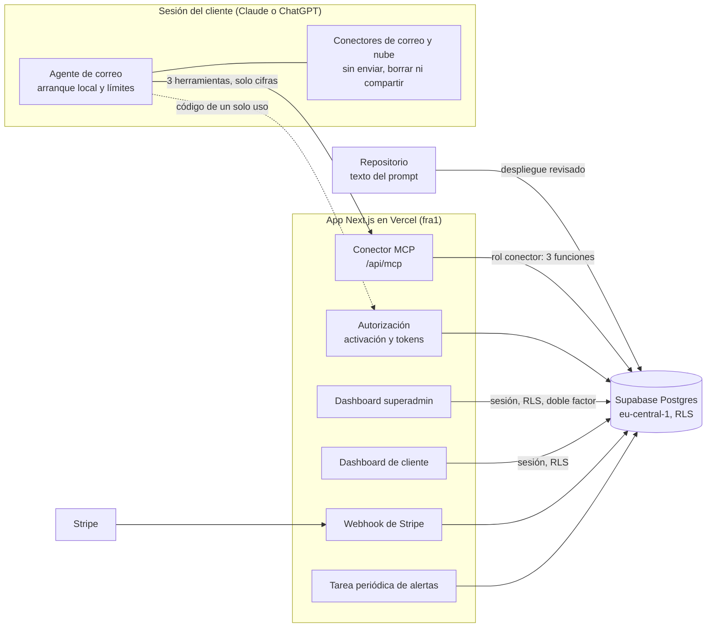

# Arquitectura de alto nivel

Estado: PROPUESTA de referencia. El detalle de cada pieza se fija en el `diseno.md` de su función.

## Contexto

## Piezas

| Pieza | Responsabilidad | No hace |
| --- | --- | --- |
| Arranque local | Texto corto en la sesión del cliente: llama a `obtener_instrucciones`, sigue lo recibido y conserva los límites | No confía en instrucciones que relajen sus límites |
| Conector MCP | Valida el token, llama a una función de la base de datos por herramienta, devuelve el resultado | No consulta tablas, no recibe identificadores de cliente, no registra valores recibidos |
| Autorización | Pantalla de activación, emisión y rotación de tokens, metadatos OAuth | No acepta callbacks fuera de la lista cerrada |
| Dashboard superadmin | Clientes, licencias, conexiones, órdenes, canales y versiones, alertas, estado de cobro | No edita el texto del prompt, no emite facturas |
| Dashboard de cliente | Resumen propio | No ve nada de otros clientes ni datos internos |
| Webhook de Stripe | Verifica la firma, anota el evento, relee el estado en Stripe y actualiza la suscripción | No guarda la carga del evento |
| Tarea periódica | Calcula alertas: sin señal, ejecución sin informe, orden sin confirmar, gracia vencida | — |
| Base de datos | Fuente de verdad y última línea del aislamiento | — |

## Flujos

### 1. Activación

1. Un superadmin crea el cliente y su licencia y genera un código de activación (un solo uso, caduca en minutos).
2. En el asistente del cliente se añade el conector con su URL. El asistente descubre los metadatos y abre la pantalla de autorización.
3. Se introduce el código. Si es válido, se crea una conexión ligada a la licencia y el asistente recibe sus tokens.
4. El panel muestra la conexión nueva y genera una alerta informativa.

### 2. Revisión del agente

1. El agente llama a `obtener_instrucciones`. El servidor responde siempre con un estado: `activa`, `pausada` o `suspendida`. Solo con `activa` entrega versión, prompt, reglas y orden vigente. Se abre una ejecución.
2. El agente trabaja en el correo y la nube del cliente. Nada de eso pasa por nuestro servidor.
3. El agente llama a `enviar_informe` con las cifras. Se cierra la ejecución.
4. Si recibió una orden, llama a `confirmar_orden`.

Si el paso 1 falla o no devuelve instrucciones válidas, el agente no toca el correo.

### 3. Publicación de una versión del prompt

1. El texto nuevo entra en `prompts/agente-ia/` por una petición de cambio revisada.
2. El despliegue registra la versión con su huella. A partir de ahí es inmutable.
3. Un superadmin la publica en el canal `prueba`. Sale un aviso fuera del panel.
4. Tras la permanencia mínima y con métricas correctas, la publica en `estable`.
5. La vuelta atrás es otra publicación que apunta a la versión anterior.

### 4. Orden pausar o reanudar

1. Un superadmin crea la orden.
2. El agente la recibe en su siguiente `obtener_instrucciones` y la aplica.
3. El agente la confirma. Si no llega la confirmación en plazo, se genera alerta.

### 5. Cobro

1. Stripe cobra la suscripción y avisa por webhook.
2. El servidor relee el estado en Stripe y actualiza `suscripciones`.
3. `past_due` abre alerta y periodo de gracia; `unpaid` o `canceled` suspenden la licencia, salvo estado manual.

## Fronteras de confianza

| Frontera | Qué cruza | Control principal |
| --- | --- | --- |
| Asistente del cliente → conector | Llamadas a herramientas con token | OAuth, token ligado a una conexión, esquema cerrado |
| Navegador → dashboards | Sesión de usuario | Supabase Auth, RLS, doble factor en superadmin |
| Stripe → webhook | Eventos | Firma, anotación del identificador, relectura en Stripe |
| App → base de datos | Consultas | Rol propio del conector; sesión del usuario en dashboards; clave secreta confinada |
| Repositorio → producción | Código y texto del prompt | Rama protegida, revisión, CI |
| Servidor → agente del cliente | Prompt y reglas | Versiones inmutables, canal de prueba, límites en el anfitrión |

## Datos

| Se guarda | No se guarda nunca |
| --- | --- |
| Nombre comercial del cliente y correos de acceso de sus usuarios | Asuntos, remitentes, direcciones o textos de correos |
| Estado de licencia, conexiones y tokens (como HMAC) | Nombres de documentos o de carpetas del cliente |
| Cifras y estados de cada revisión; códigos de problema | Frases libres del agente |
| Versiones del prompt y a qué canal sirven | Carga de los eventos de Stripe (lleva correo e IBAN) |
| Estado de cobro e identificadores de Stripe | Datos de tarjeta o de cuenta bancaria |
| Auditoría de acciones de superadmin | Valores recibidos en peticiones rechazadas |

## Entornos

| Entorno | App | Base de datos | Datos |
| --- | --- | --- | --- |
| Desarrollo | Local | Proyecto de desarrollo en la UE (no hay base local: la máquina no tiene Docker) | Ficticios |
| Previo | Despliegue de vista previa en `fra1` | Rama o proyecto separado en la UE (V-114) | Ficticios |
| Producción | Vercel `fra1` | Supabase Pro `eu-central-1` | Reales |

Cada entorno tiene sus propios secretos. Ningún dato real sale de producción.

## Fallos previstos

| Fallo | Comportamiento |
| --- | --- |
| Conector caído o token inválido | El agente no recibe instrucciones y no toca el correo. El panel lo muestra como «sin señal» |
| Informe que no llega | La ejecución queda abierta y genera alerta |
| Renovación de token simultánea | La ventana de gracia devuelve el mismo par; no se revoca la conexión |
| Webhook de Stripe repetido o desordenado | Se ignora el repetido y se relee el estado real |
| Versión con errores publicada | Vuelta atrás desde el panel; se aplica en la siguiente revisión |
| Cuenta de superadmin comprometida | Doble factor, auditoría, aviso de publicación y versiones inmutables limitan el daño; pausa global |

## Objetivos de servicio

PROPUESTOS; se fijan en la fase 4, con datos reales.

- Disponibilidad del conector: 99,5 % mensual.
- `obtener_instrucciones`: 95 % de las llamadas en menos de 1 segundo.
- Detección de un agente sin señal: antes de 2 veces su frecuencia esperada.
